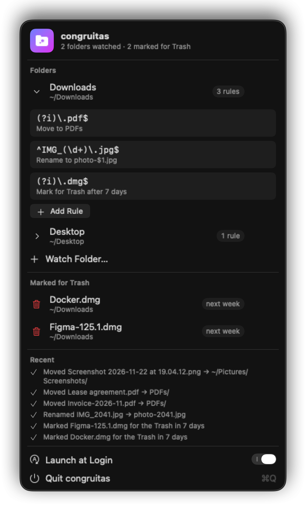

# congruitas

A macOS menu bar app that keeps folders sorted. Each watched folder has its own regex rules. When a file lands in the folder, the first rule whose pattern matches the file name acts on it.



## Rules

| Action | Template | Example |
|---|---|---|
| Move to | Target folder: relative to the watched folder, absolute, or `~/…` | `(?i)\.pdf$` → `PDFs` |
| Rename to | The new file name | `^IMG_(\d+)\.jpg$` → `photo-$1.jpg` |
| Mark for Trash | Number of days | `\.dmg$` → after 7 days |

- **Patterns** are `NSRegularExpression` patterns, matched against the file name. Add `^…$` to match the whole name and `(?i)` to ignore case.
- **Templates** take `$0` (the whole match), `$1`, `$2`… from the match. Write `\$` for a literal `$`.
- **Saving.** Rules are edited on a copy and only run after you click Save. Saving runs them on the folder's existing files right away.
- **Preview.** While you edit, each rule shows how many files in the folder it would act on now. A list below the rules shows which files, and what would happen to each.
- **Scope.** Only files and packages directly in the folder are sorted. Hidden files and subfolders are left alone.
- **Name clashes.** Moves and renames never overwrite an existing file. If the file already there is identical, the new copy is a duplicate and goes to the Trash. If it's different, both are kept and the new one becomes `name (1).ext`. In the preview, a clash shows as "name taken".

## Marked for Trash

Files aren't trashed right away. A matching file gets a red **To Trash** Finder tag and appears under *Marked for Trash* in the menu bar panel, with its date. When the date passes, the file goes to the Trash, so you can still put it back.

To keep a marked file, click ↩ in the panel or remove the tag in Finder. Either way, that folder's rules leave the file alone from then on.

## How it works

- **Watching.** Each folder is watched with a dispatch source. A scan runs once the folder has been quiet for a second, and every hour so that due files get trashed.
- **State on the file.** The trash date, and the "already handled here" marker that stops a rename from looping, are stored in extended attributes (`com.sovrin.congruitas.*`), so they move with the file.
- **Config.** Watched folders and their rules are stored in `~/Library/Application Support/Congruitas/folders.json`.

## Build

```sh
./build.sh            # builds congruitas.app (Xcode 27, macOS 26.6+)
open congruitas.app
checks/run.sh         # self-check for the rule logic and file marks
```
